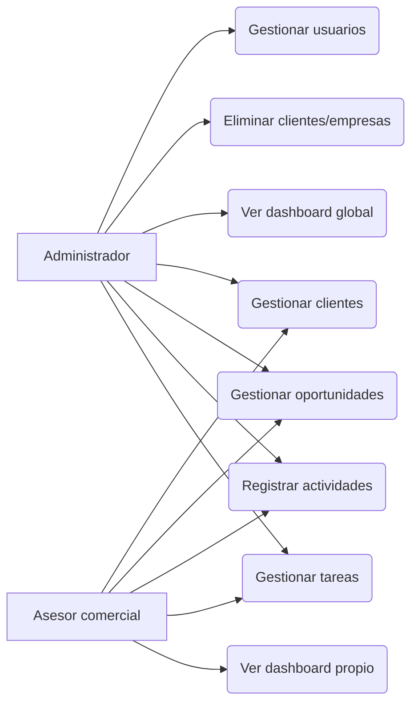

# Fase 1 – Análisis y planificación

## Nombre del sistema
**NexoCRM** – Sistema de gestión de relaciones con clientes (nombre provisional, modificable).

## Descripción del problema
Muchas organizaciones pequeñas y medianas gestionan clientes, seguimientos y ventas en hojas de cálculo o mensajes dispersos. Esto genera duplicidad de datos, pérdida de oportunidades, falta de trazabilidad de las interacciones y ausencia de indicadores para decidir.

## Justificación
Centralizar la información comercial en una aplicación web con base de datos documental en la nube permite acceso desde cualquier lugar, trazabilidad por cliente y métricas calculadas sobre datos reales.

## Objetivo general
Desarrollar una aplicación web CRM cliente-servidor, con API REST y base de datos documental (MongoDB Atlas), que centralice clientes, empresas, oportunidades, actividades y tareas.

## Objetivos específicos
1. Diseñar un modelo documental en MongoDB con seis colecciones relacionadas por referencias.
2. Implementar una API REST segura (JWT, roles, validación) con Node.js y Express.
3. Construir una interfaz React responsive con dashboard, tablas, modales y tablero Kanban.
4. Calcular indicadores del dashboard con agregaciones sobre datos reales.
5. Validar el sistema con pruebas automatizadas (Jest + Supertest) y documentar el despliegue.

## Alcance
**Incluye:** autenticación, roles (admin / asesor), CRUD de clientes, empresas, oportunidades, actividades y tareas; búsqueda, filtros, paginación, ordenamiento; dashboard; seed de demostración separado.
**No incluye:** envío real de correos, integración con telefonía, facturación, app móvil nativa, multi-tenant.

## Decisiones técnicas (justificadas por sencillez y seguridad)
| Decisión | Justificación |
|---|---|
| Express 4 | Ecosistema de middleware de seguridad más estable y documentado. |
| Validación con Zod en backend y en frontend | Un solo esquema conceptual, mensajes consistentes. |
| Axios con interceptor | Adjunta el JWT y maneja 401 de forma centralizada. |
| Registro público solo para el **primer** usuario (admin inicial) | Evita que cualquiera cree administradores; después solo un admin crea usuarios. |
| Referencias (ObjectId) y no incrustación | Ver `modelo-datos.md`. |
| JWT en cabecera `Authorization: Bearer` | Sencillo; se documentan los riesgos de almacenarlo en el navegador. |

## Requerimientos funcionales
| ID | Requerimiento |
|---|---|
| RF-01 | Iniciar y cerrar sesión; proteger rutas privadas. |
| RF-02 | Registrar el administrador inicial; el admin crea asesores. |
| RF-03 | Roles con permisos: admin (todo), asesor (sus datos asignados; no elimina clientes/empresas ni gestiona usuarios). |
| RF-04 | CRUD de clientes con búsqueda (nombre, correo, identificación) y filtros (tipo, estado). |
| RF-05 | Evitar duplicados de identificación y correo de cliente. |
| RF-06 | Consultar historial de actividades por cliente. |
| RF-07 | CRUD de empresas y consulta de contactos asociados. |
| RF-08 | CRUD de oportunidades, asignación de responsable, valor, fecha de cierre y estado. |
| RF-09 | Tablero Kanban con cambio de estado de oportunidades. |
| RF-10 | Registro y consulta de actividades con próximo seguimiento. |
| RF-11 | CRUD de tareas, prioridades, estados, consulta de vencidas y filtros. |
| RF-12 | Dashboard con indicadores y gráficos calculados desde MongoDB. |
| RF-13 | Confirmación antes de eliminar. |

## Requerimientos no funcionales
| ID | Requerimiento |
|---|---|
| RNF-01 | Contraseñas con bcrypt; sin texto plano. |
| RNF-02 | Secretos en variables de entorno; `.env` fuera de Git. |
| RNF-03 | Validación en cliente y servidor; manejo centralizado de errores. |
| RNF-04 | Interfaz responsive (móvil, tablet, escritorio). |
| RNF-05 | Paginación en todos los listados (por defecto 10 registros). |
| RNF-06 | Código modular por capas; pruebas automatizadas. |
| RNF-07 | CORS restringido al origen del frontend; helmet y rate-limit. |

## Casos de uso (resumen)

## Fuentes oficiales (a consultar durante el desarrollo)
- MongoDB (modelado de datos): https://www.mongodb.com/docs/manual/data-modeling/
- MongoDB Atlas: https://www.mongodb.com/docs/atlas/
- Mongoose: https://mongoosejs.com/docs/
- Express: https://expressjs.com/
- Node.js: https://nodejs.org/en/docs
- React: https://react.dev/
- OWASP Cheat Sheet Series: https://cheatsheetseries.owasp.org/
- OWASP Top 10: https://owasp.org/www-project-top-ten/
