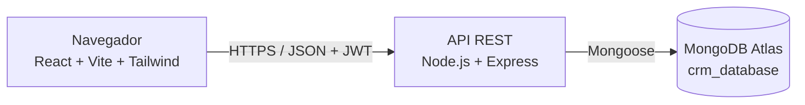

# Arquitectura

## Capas del backend
`routes` → `middleware` (auth, roles, validación) → `controllers` → `services` (lógica de negocio) → `models` (Mongoose) → MongoDB.
Errores: middleware centralizado `errorHandler`.

## Capas del frontend
`pages` (vistas) → `components` (UI reutilizable) → `services` (Axios) → API. Estado de sesión en `context/AuthContext`. Rutas privadas con `ProtectedRoute` y chequeo de rol.

## Seguridad prevista
bcrypt, JWT con expiración, helmet, rate-limit en `/auth`, sanitización contra inyección NoSQL, CORS por origen, validación Zod, variables de entorno.
Referencias: OWASP Cheat Sheet Series (https://cheatsheetseries.owasp.org/).
