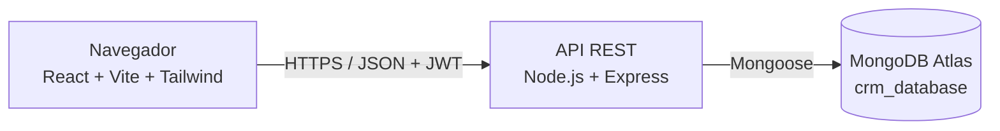

# Arquitectura

## Capas del backend
`routes` → `middleware` (auth, roles, validación) → `controllers` → `services` (lógica de negocio) → `models` (Mongoose) → MongoDB.
Errores: middleware centralizado `errorHandler`.

## Capas del frontend
`pages` (vistas) → `components` (UI reutilizable) → `services` (Axios) → API. Estado de sesión en `context/AuthContext`. Rutas privadas con `ProtectedRoute` y chequeo de rol.

## Seguridad prevista
bcrypt, JWT con expiración, helmet, rate-limit en `/auth`, sanitización contra inyección NoSQL, CORS por origen, validación Zod, variables de entorno.
Referencias: OWASP Cheat Sheet Series (https://cheatsheetseries.owasp.org/).

## Decisiones técnicas verificadas en la implementación
- **bcryptjs** (implementación en JavaScript del algoritmo bcrypt) con 10 rondas de sal. Se eligió frente al paquete nativo `bcrypt` para evitar la compilación de módulos nativos en Windows y en Render.
- **Express 4** y **Zod** para validar el cuerpo de cada petición; el middleware `validate` reemplaza `req.body` por los datos limpios.
- **Alcance por rol** centralizado en `services/crudFactory.js`; las reglas específicas de cada módulo (integridad, filtros) están en su controlador.
- **Dashboard:** `controllers/dashboardController.js` usa `countDocuments` y `aggregate` (`$group`, `$dateToString`) sobre las colecciones reales; los meses sin registros se completan con 0 para estabilizar los gráficos.
- **Frontend:** estado de sesión en `AuthContext`; peticiones con Axios y un interceptor que adjunta el JWT y cierra la sesión ante un 401; el hook `useList` unifica paginación, orden, búsqueda y filtros.
- **Fechas:** las fechas con hora se guardan en UTC; las fechas sin hora (cierre estimado) se muestran en UTC para que no retrocedan un día en husos horarios al oeste de Greenwich; los vencimientos de tareas y seguimientos se guardan al final del día local elegido.
