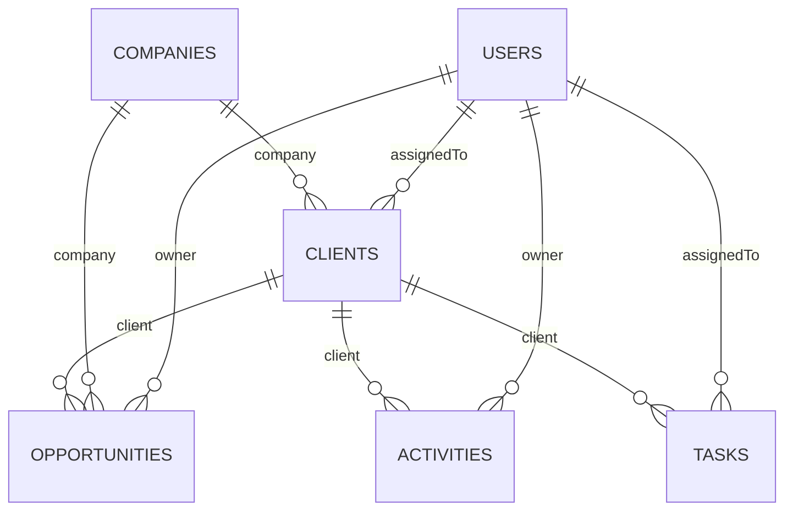

# Modelo documental – base `crm_database`

Todas las colecciones incluyen `createdAt` y `updatedAt` (opción `timestamps: true` de Mongoose).

## Diagrama de relaciones


## ¿Por qué referencias y no incrustación?
- **Cardinalidad no acotada:** un cliente puede acumular cientos de actividades; incrustarlas haría crecer el documento sin límite (el tamaño máximo de un documento BSON es 16 MB).
- **Acceso independiente:** actividades, tareas y oportunidades se consultan, filtran y paginan por sí solas (dashboard, Kanban).
- **Evita duplicación:** los datos de una empresa viven en un solo lugar y se actualizan una vez.
- Se usa `populate` de Mongoose para traer los datos relacionados cuando la vista los necesita.
- Se acepta incrustar solo datos pequeños y estables (ninguno en este diseño).

Referencia: https://www.mongodb.com/docs/manual/data-modeling/

## 1. `users`
| Campo | Tipo | Reglas |
|---|---|---|
| name | String | requerido, 2–80 |
| email | String | requerido, único, minúsculas, formato válido |
| password | String | requerido, hash bcrypt, `select: false` |
| role | String | enum `admin` \| `advisor`, default `advisor` |
| active | Boolean | default `true` |

Índices: `email` (único).
```json
{ "_id": "665f0c1e8a1b2c3d4e5f0001", "name": "Laura Gómez", "email": "laura@ejemplo.com",
  "password": "$2b$10$…(hash)…", "role": "admin", "active": true }
```

## 2. `companies`
| Campo | Tipo | Reglas |
|---|---|---|
| name | String | requerido |
| taxId (NIT) | String | requerido, único |
| sector | String | opcional |
| email, phone, address, city, website, description | String | opcionales; email con formato |

Índices: `taxId` (único), texto en `name`.
```json
{ "_id": "665f0c1e8a1b2c3d4e5f0101", "name": "Andina Logística S.A.S.", "taxId": "900123456-7",
  "sector": "Transporte", "email": "info@andina.co", "phone": "+57 4 555 0101",
  "address": "Cra 43A # 1-50", "city": "Medellín", "website": "https://andina.co",
  "description": "Operador logístico regional" }
```

## 3. `clients`
| Campo | Tipo | Reglas |
|---|---|---|
| fullName | String | requerido |
| idType | String | enum `CC`,`CE`,`NIT`,`PAS`,`TI`,`OTRO` |
| idNumber | String | requerido, único |
| email | String | requerido, único |
| phone, address, city | String | phone requerido |
| company | ObjectId → companies | opcional |
| clientType | String | enum `persona`,`empresa`,`prospecto` |
| status | String | enum `activo`,`inactivo`,`potencial` |
| assignedTo | ObjectId → users | opcional |
| notes | String | opcional |
| registeredAt | Date | default ahora |

Índices: `idNumber` único, `email` único, `status+clientType`, texto en `fullName`.
```json
{ "_id": "665f0c1e8a1b2c3d4e5f0201", "fullName": "Carlos Ruiz", "idType": "CC", "idNumber": "1020304050",
  "email": "carlos@andina.co", "phone": "3001234567", "address": "Calle 10 # 20-30", "city": "Medellín",
  "company": "665f0c1e8a1b2c3d4e5f0101", "clientType": "persona", "status": "activo",
  "assignedTo": "665f0c1e8a1b2c3d4e5f0001", "notes": "Prefiere contacto por correo" }
```

## 4. `opportunities`
| Campo | Tipo | Reglas |
|---|---|---|
| title | String | requerido |
| client | ObjectId → clients | requerido |
| company | ObjectId → companies | opcional |
| owner | ObjectId → users | requerido |
| estimatedValue | Number | ≥ 0 |
| expectedCloseDate | Date | opcional |
| status | String | enum `nueva`,`en_contacto`,`en_negociacion`,`ganada`,`perdida` |
| description | String | opcional |

Índices: `status`, `owner`, `client`.
```json
{ "_id": "665f0c1e8a1b2c3d4e5f0301", "title": "Contrato de transporte anual", "client": "665f0c1e8a1b2c3d4e5f0201",
  "company": "665f0c1e8a1b2c3d4e5f0101", "owner": "665f0c1e8a1b2c3d4e5f0001", "estimatedValue": 45000000,
  "expectedCloseDate": "2026-12-15T00:00:00Z", "status": "en_negociacion" }
```

## 5. `activities`
| Campo | Tipo | Reglas |
|---|---|---|
| client | ObjectId → clients | requerido |
| owner | ObjectId → users | requerido |
| type | String | enum `llamada`,`correo`,`reunion`,`visita`,`seguimiento`,`otra` |
| description | String | requerido |
| date | Date | requerido |
| result | String | opcional |
| nextFollowUp | Date | opcional, ≥ `date` |

Índices: `client+date` (desc), `owner`.
```json
{ "_id": "665f0c1e8a1b2c3d4e5f0401", "client": "665f0c1e8a1b2c3d4e5f0201", "owner": "665f0c1e8a1b2c3d4e5f0001",
  "type": "llamada", "description": "Llamada para presentar propuesta", "date": "2026-11-03T15:00:00Z",
  "result": "Solicita cotización", "nextFollowUp": "2026-11-10T15:00:00Z" }
```

## 6. `tasks`
| Campo | Tipo | Reglas |
|---|---|---|
| title | String | requerido |
| description | String | opcional |
| assignedTo | ObjectId → users | requerido |
| client | ObjectId → clients | opcional |
| dueDate | Date | requerido |
| priority | String | enum `baja`,`media`,`alta` |
| status | String | enum `pendiente`,`en_progreso`,`completada` |

Índices: `assignedTo+status`, `dueDate`.
```json
{ "_id": "665f0c1e8a1b2c3d4e5f0501", "title": "Enviar cotización", "assignedTo": "665f0c1e8a1b2c3d4e5f0001",
  "client": "665f0c1e8a1b2c3d4e5f0201", "dueDate": "2026-11-08T00:00:00Z", "priority": "alta", "status": "pendiente" }
```

## Reglas de integridad a nivel de aplicación
- Un cliente con oportunidades asociadas **no se puede eliminar** (respuesta 409). Si no las tiene, al eliminarlo se eliminan también sus actividades y tareas.
- Una empresa con clientes u oportunidades asociados **no se puede eliminar** (409).
- Los usuarios **no se eliminan**: se desactivan (conservan su historial) y pueden reactivarse. Un usuario desactivado no puede iniciar sesión y su token deja de ser válido de inmediato.
- Un asesor solo ve y edita los registros donde es responsable (`assignedTo` en clientes y tareas; `owner` en oportunidades y actividades) y no puede reasignarlos. Las empresas son compartidas.
- Antes de guardar se verifica que los `ObjectId` referenciados existan (y, para asesores, que el cliente sea suyo).
- Si una oportunidad no indica empresa, hereda la del cliente.
- El próximo seguimiento de una actividad no puede ser anterior a su fecha (validador de Mongoose).
- Los campos desconocidos enviados al API se descartan (Zod), evitando asignación masiva.
